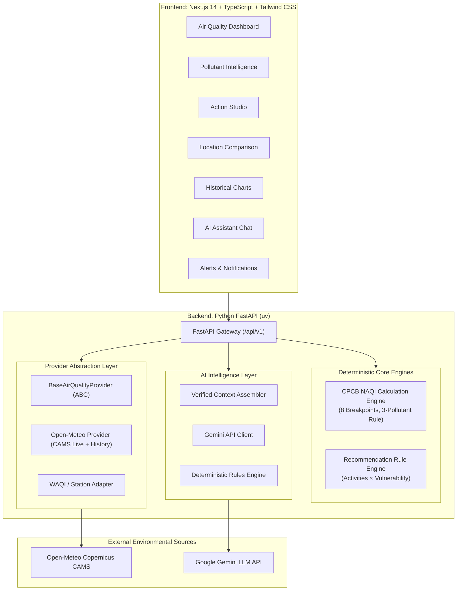

# AirAware AI — Intelligent Urban Air Quality Monitoring & Personalised Action Assistant

> **An environmental intelligence platform that transforms Copernicus CAMS Global atmospheric model data into location-aware, accessible, and actionable health guidance using India's CPCB National Air Quality Index (NAQI) breakpoints (`INDICATIVE_MODEL_INDEX`).**

---

## 1. Project Overview

- **Selected Vertical:** Urban Air Quality Assistant (Hack2Skill Challenge 6)

**AirAware AI** is an urban air quality assistant designed to solve the usability, reliability, and data-integrity challenges associated with interpreting urban air pollution.

Unlike generic AQI apps that display raw numbers without context or attach an ungrounded chatbot that invents air quality values, AirAware AI ingests **model-derived criteria pollutant series** (`PM2.5`, `PM10`, `NO2`, `SO2`, `CO`, `O3`) from Copernicus CAMS Global via Open-Meteo, applies Stage 1 gap-aware rolling-window integration, and evaluates them using India's **Central Pollution Control Board (CPCB) National Air Quality Index (NAQI)** breakpoints as a clearly labeled **`INDICATIVE_MODEL_INDEX`** (not an official CAAQMS station reading). It couples this with a **deterministic Personalised Action Studio** and a **server-grounded AI assistant** with automatic offline deterministic fallback.

---

## 2. Problem Statement

Rapid urbanization and seasonal meteorological inversions across South Asia and global metropolitan areas have made air pollution a persistent public health emergency. However, urban residents encounter severe barriers with existing tools:
1. **Misleading AQI Calculations**: Many consumer dashboards label raw PM2.5 concentrations as "AQI" or apply US EPA breakpoints to Indian atmospheric baselines, leading to confusion.
2. **Abstract Numbers Without Context**: Telling a citizen that AQI is "240" offers little clarity on which specific pollutant is driving the toxicity or what concrete precautions to take.
3. **One-Size-Fits-All Advice**: A marathon runner, an asthmatic child, and an office commuter require starkly different preventive measures.
4. **AI Hallucinations**: Standard LLMs invent air quality readings, hallucinate historical trends, or prescribe speculative medical therapies.
5. **Data Fabrication**: Many prototype dashboards rely on mock data or silently replace missing sensor measurements with zero, distorting public health reality.

---

## 3. Proposed Solution

AirAware AI addresses these foundational issues through five engineering pillars:
- **Zero Mock / Zero Fabricated Data**: Direct integration with the Open-Meteo Air Quality API powered by Copernicus Atmosphere Monitoring Service (CAMS Global) model-derived estimates, with explicit temporal governance, grid-snap provenance, and cycle freshness indicators. Always labeled `INDICATIVE_MODEL_INDEX` (never misrepresented as an official CPCB physical CAAQMS station reading).
- **CPCB NAQI Breakpoint & Rolling-Window Engine**: Trapezoidal rolling-window integration (`Gmax = 14,400s`), CPCB 8-pollutant linear interpolation breakpoints with `ROUND_HALF_UP` integer conversion, and the mandatory 3-pollutant sufficiency rule (including PM2.5 or PM10).
- **Deterministic Personalised Action Studio**: Rule-based decision matrix mapping indicative index categories, dominant pollutants, 6 activity types, 6 vulnerability cohorts, and exposure durations to explainable precautions (`triggered_rules`).
- **Server-Grounded AI Assistant with Offline Fallback**: Conversational agent that constructs an immutable server-side `VerifiedContextSnapshot` and fact registry (`extra="forbid"` rejects client-supplied AQI/context), with automatic deterministic fallback when `GEMINI_API_KEY` is unconfigured or LLM output fails verification.
- **Transparent Multi-Location & Historical Intelligence**: Comparative analytics (`POST /api/v1/air-quality/compare`) and hourly historical trends with data integrity warnings.

---

## 4. Key Features

### Feature A — Comprehensive Air Quality Dashboard
- **Semicircular SVG Gauge**: Visualizes the composite `INDICATIVE_MODEL_INDEX` with CPCB category colors (Good, Satisfactory, Moderate, Poor, Very Poor, Severe) and explicit non-station disclosure.
- **Dominant Pollutant Callout**: Highlights the primary pollutant driving the indicative index and explains why it matters.
- **Provenance Badges**: Displays city/grid coordinates (`geodesic_snap_distance_km`), `valid_time`, `retrieval_time`, data source (`cams_global`), and cycle freshness status (`CURRENT_CYCLE`, `AGING_CYCLE`, `STALE_CYCLE`).

### Feature B — Pollutant Intelligence Grid
- **Model-Derived Breakdown**: Interactive cards for PM2.5, PM10, NO2, SO2, CO, O3, and NH3 with concentrations ($\mu g/m^3$, $mg/m^3$), averaging periods, and individual sub-indices.
- **Educational Deep-Dive**: Modals explaining chemical nature, primary emission sources (vehicular, industrial, agricultural), and respiratory impacts.
- **Honest Missing Data Handling**: Unavailable or insufficient pollutants (such as `NH3`) are explicitly labeled as unavailable rather than silently assumed to be zero.

### Feature C — Personalised Action Studio
- **Multi-Factor Customization**:
  - **Activities**: Walking, Running, Cycling, Commuting, Outdoor Sports, Indoor.
  - **Sensitivity Cohorts**: General Adults, Children (<14 yrs), Elderly (60+ yrs), Asthma/Respiratory, Cardiovascular, Pregnant Individuals.
  - **Exposure Duration**: <30 mins, 30–60 mins, 1–2 hours, >2 hours.
- **Actionable Outputs**: Risk advisory level, step-by-step precautions, protective mask guidance (N95/FFP2), indoor ventilation advice, `triggered_rules` provenance, uncertainty notes, and non-medical disclaimers.

### Feature D — Multi-Location Comparison
- **Matrix Comparator**: Compare 2 to 6 supported cities simultaneously (e.g., New Delhi, Mumbai, Bengaluru, Kolkata, Chennai, Hyderabad).
- **Side-by-Side Pollutant Breakdown**: Comparative table of indicative index values, dominant pollutants, and concentrations.
- **Data Integrity Safeguard**: Surfaces warnings for mismatched timestamps, grid-cell snapping, or partial provider failures.

### Feature E — Historical Trends
- **Hourly Model Series**: Area charts plotting 24 hours, 7 days, 14 days, or 30 days of hourly CAMS atmospheric model data.
- **Metric Toggling**: Switch between Index, PM2.5, PM10, NO2, SO2, CO, and O3.
- **Statistical Summary**: Calculation of period average, peak reading, and lowest recorded hour.

### Feature F — Server-Grounded AI Assistant
- **Immutable Server Context**: Backend assembles `VerifiedContextSnapshot` and a fact registry directly from provider assessments (`extra="forbid"` rejects client-supplied readings).
- **Quick Suggested Chips**: Single-click access to key questions ("What does the current AQI mean for my health?", "Which pollutant is contributing most right now?").
- **Deterministic Fallback**: Automatically discloses deterministic fallback mode and serves grounded factual guidance even without a `GEMINI_API_KEY`.

### Feature G — User-Configurable Threshold Alerts
- **Customizable Thresholds**: Set client-side alerts on backend-assessed indicative index values (e.g., `>= 200`), with explicit staleness/model-derived disclosure.
- **Duplicate Prevention**: Deduplicates alert triggers within a 3-hour window.
- **Persistent Notification Log**: Stored in browser local storage.

### Feature H — Methodology & Provenance Transparency
- Complete documentation of CPCB breakpoints, interpolation formula, and data provider attribution accessible directly within the application.

---

## 5. System Architecture



---

## 6. Technologies Used

- **Frontend**: Next.js 14 (App Router), React 18, TypeScript, Tailwind CSS, Lucide React, Recharts.
- **Backend**: Python 3.11, FastAPI, Pydantic v2, Uvicorn, HTTPX (Async), Python-Dotenv.
- **Tooling & Package Management**: Astral `uv` (high-performance Python tooling), npm, Node.js v22.
- **Testing**: Pytest, Pytest-Asyncio, FastAPI TestClient.

---

## 7. Data Sources & Provenance

AirAware AI queries model-derived atmospheric grid data:
- **Primary Provider**: Open-Meteo Air Quality API powered by the **Copernicus Atmosphere Monitoring Service (`cams_global`)**. Values represent ~0.4° atmospheric model grid estimates (`INDICATIVE_MODEL_INDEX`), **not** physical CPCB continuous ambient air quality monitoring station (`CAAQMS`) measurements.
- **Averaging Periods**: 24-hour rolling window for PM2.5, PM10, NO2, SO2, NH3, Pb; 8-hour rolling window for CO and O3 (`Gmax = 14,400s`).
- **Units**: Concentrations are normalized to standard metric units ($\mu g/m^3$ for particulate matter and gases; $mg/m^3$ for carbon monoxide).

---

## 8. CPCB AQI Methodology

Under India's **Central Pollution Control Board (CPCB) National Air Quality Index** guidelines:

### Sub-Index Interpolation Formula
$$I_p = \frac{I_{hi} - I_{lo}}{B_{hi} - B_{lo}} \times (C_p - B_{lo}) + I_{lo}$$

Where:
- $C_p$ = Pollutant concentration
- $B_{hi}, B_{lo}$ = Breakpoint concentration interval containing $C_p$
- $I_{hi}, I_{lo}$ = Sub-index interval corresponding to $B_{hi}, B_{lo}$

### CPCB Official Breakpoints Table

| Category | AQI Range | PM10 (24h) | PM2.5 (24h) | NO2 (24h) | O3 (8h) | CO (8h, mg/m³) | SO2 (24h) |
|---|---|---|---|---|---|---|---|
| **Good** | 0 – 50 | 0 – 50 | 0 – 30 | 0 – 40 | 0 – 50 | 0.0 – 1.0 | 0 – 40 |
| **Satisfactory** | 51 – 100 | 51 – 100 | 31 – 60 | 41 – 80 | 51 – 100 | 1.1 – 2.0 | 41 – 80 |
| **Moderate** | 101 – 200 | 101 – 250 | 61 – 90 | 81 – 180 | 101 – 168 | 2.1 – 10.0 | 81 – 380 |
| **Poor** | 201 – 300 | 251 – 350 | 91 – 120 | 181 – 280 | 169 – 208 | 10.1 – 17.0 | 381 – 800 |
| **Very Poor** | 301 – 400 | 351 – 430 | 121 – 250 | 281 – 400 | 209 – 748 | 17.1 – 34.0 | 801 – 1600 |
| **Severe** | 401 – 500 | 430+ | 250+ | 400+ | 748+ | 34.0+ | 1600+ |

### CPCB Sufficiency Rules Enforced by AirAware AI
1. **Minimum 3 Pollutants**: At least three criteria pollutants must be present.
2. **Mandatory Particulate Matter**: At least one of PM10 or PM2.5 MUST be monitored.
3. **Composite AQI**: Overall AQI = $\max(I_{PM2.5}, I_{PM10}, I_{NO2}, I_{SO2}, I_{CO}, I_{O3}, \dots)$.
4. **Dominant Pollutant**: Pollutant with $I_p = \text{Overall AQI}$.

---

## 9. How the Application Works

1. **Selection & Ingestion**: The user chooses a city from the quick switcher, searches for an urban center, or passes custom coordinates.
2. **Ingestion & Calculation**: The backend fetches CAMS Global series from Open-Meteo, normalizes units and temporal metadata (`temporal_validation.py`), integrates rolling windows (`rolling_window.py`), and computes `INDICATIVE_MODEL_INDEX` via `indicative_index.py` and `cpcb_calculator.py`.
3. **Deterministic Evaluation**: `recommendation_rules.py` cross-references the AQI and dominant pollutant with the user's selected activity, vulnerability cohort, and exposure duration.
4. **Context Grounding**: The AI assistant accepts the verified state as an immutable context envelope, answering questions without speculative extrapolation.
5. **Real-time Alerting**: The frontend checks the calculated AQI against client-configured alert rules and surfaces immediate warning banners if thresholds are crossed.

---

## 10. AI Service Usage & Limitations

- **Strict Grounding**: The LLM prompt is assembled with pre-calculated, verified environmental context. The system instruction strictly prohibits inventing numbers, overriding calculated categories, or making ungrounded causal claims.
- **Non-Medical Boundary**: The AI assistant explicitly refuses to prescribe medical therapies, diagnose diseases, or offer clinical guarantees.
- **Offline / Zero-Config Operation**: If `GEMINI_API_KEY` is not provided or upstream network requests fail, the application falls back seamlessly to its internal deterministic rules engine, providing instant, accurate answers to common inquiries without breaking.

---

## 11. Installation Instructions

### Prerequisites
- Node.js (v18+ or v22 LTS)
- Python 3.11+
- Astral `uv` (recommended) or standard `pip`

### Step 1: Clone the Repository
```bash
git clone https://github.com/<your-username>/AirAware-AI.git
cd AirAware-AI
```

### Step 2: Configure Environment Variables
```bash
cp .env.example .env
```

### Step 3: Backend Setup
```bash
cd backend
# Using uv (recommended)
uv venv
uv pip install -e ".[dev]"

# Or using standard venv:
python -m venv .venv
source .venv/bin/activate  # On Windows: .venv\Scripts\activate
pip install -e ".[dev]"
```

### Step 4: Frontend Setup
```bash
cd ../frontend
npm install
```

---

## 12. Environment Variables

See `.env.example`:

| Variable | Description | Default / Required |
|---|---|---|
| `PORT` | FastAPI backend server port | `8000` |
| `HOST` | Backend bind address | `127.0.0.1` |
| `ALLOWED_ORIGINS` | CORS permitted origins | `http://localhost:3000,http://127.0.0.1:3000` |
| `AIRAWARE_MAX_SUPPORTED_GAP_SECONDS` | Rolling-window max gap (`Gmax`) | `14400.0` (4 hours) |
| `AIRAWARE_CACHE_TTL_SECONDS` | Backend response cache TTL | `600` |
| `AIRAWARE_RATE_LIMIT_PER_MIN` | Per-client rate limit | `120` |
| `GEMINI_API_KEY` | Google Gemini API key for conversational AI | *Optional* (Deterministic fallback included) |
| `AIRAWARE_LLM_MODEL` | Gemini model identifier | `gemini-2.0-flash` |
| `NEXT_PUBLIC_API_URL` | Frontend API base URL | `http://127.0.0.1:8000/api/v1` |

---

## 13. Testing Instructions

AirAware AI includes a comprehensive automated test suite covering CPCB breakpoint calculations, edge cases, negative values, 3-pollutant rules, recommendation matrices, and API route validation.

### Run Backend Pytest Suite
```bash
cd backend
.venv\Scripts\pytest.exe tests -v
# Or with uv:
uv run pytest tests -v
```

### Test Suite Coverage:
- `test_pm25_sub_index_breakpoints`: Verifies exact CPCB interpolation at 0, 15, 30, 60, 75, 120, 250, and 300 $\mu g/m^3$.
- `test_pm10_sub_index_breakpoints`: Validates PM10 breakpoint transitions.
- `test_co_sub_index_breakpoints`: Validates CO in $mg/m^3$.
- `test_extreme_values_and_capping`: Verifies handling of extreme smog readings (>500 cap).
- `test_negative_concentration_handling`: Confirms negative sensor anomalies are rejected.
- `test_cpcb_insufficient_data_less_than_three_pollutants`: Validates CPCB 3-pollutant sufficiency rule.
- `test_cpcb_insufficient_data_missing_pm`: Validates mandatory PM2.5/PM10 requirement.
- `test_cpcb_success_calculation_and_dominant_pollutant`: Tests composite AQI and dominant pollutant selection.
- `test_recommendation_engine`: Tests advisory escalations across activities and vulnerability cohorts.
- `test_api_routes`: End-to-end FastAPI endpoint integration, sanitization, and coordinate bounds validation.

### Run Frontend Build & Typecheck
```bash
cd frontend
npm run build
```

---

## 14. Deployment Instructions

### Option A: Local / Self-Hosted Production

1. **Start Backend**:
   ```bash
   cd backend
   .venv\Scripts\uvicorn.exe app.main:app --host 0.0.0.0 --port 8000
   ```
2. **Start Frontend**:
   ```bash
   cd frontend
   npm run build
   npm run start
   ```
   Open `http://localhost:3000` in any modern web browser.

### Option B: Cloud Hosting (Vercel + Render / Docker)
See the full production guide in [DEPLOYMENT.md](./DEPLOYMENT.md):
- **Backend (`backend/`)**: Deploy via `render.yaml` Blueprint or `backend/Dockerfile` (`healthCheckPath: /health`, `ENVIRONMENT=production`, `DEBUG=false`, explicit `ALLOWED_ORIGINS=https://<your-vercel-domain>`).
- **Frontend (`frontend/`)**: Deploy to Vercel using `frontend/vercel.json` (`Root Directory: frontend`), setting `NEXT_PUBLIC_API_URL=https://<your-backend-domain>/api/v1`.

---

## 15. Assumptions & Limitations

1. **Model-Derived Estimates vs. Physical Stations**: AirAware AI uses Open-Meteo Copernicus CAMS Global atmospheric model data (`INDICATIVE_MODEL_INDEX`), not physical CPCB continuous ambient air quality monitoring station (CAAQMS) sensors. Model grid coordinates may be snapped from requested city-center coordinates (`geodesic_snap_distance_km`).
2. **Lead (Pb) & Ammonia (NH3)**: CPCB NAQI defines breakpoints for 8 pollutants. Lead (Pb) and Ammonia (NH3) are typically unavailable in CAMS Global feeds. AirAware AI marks these as unavailable without failing the composite calculation when at least 3 criteria pollutants (including PM2.5 or PM10) meet rolling-window sufficiency.
3. **Non-Clinical Nature**: Preventive recommendations are strictly educational and non-clinical.

---

## 16. Future Improvements

- **Local IoT Sensor Integration**: Direct Bluetooth / Wi-Fi pairing with personal low-cost particulate monitors (e.g., Plantower PMS5003).
- **Hyperlocal Route Optimization**: Clean-air commuting route navigation suggesting walking and cycling paths that avoid high-emission traffic arteries.
- **Push & WhatsApp Notification Webhooks**: Automated daily morning briefings delivering the day's predicted air quality and activity advice before morning commutes.
- **Community Ground-Truth Reporting**: Crowdsourced reporting of localized biomass burning, construction dust plumes, and industrial flare-ups.

---

## License

This project is licensed under the Apache 2.0 License.
