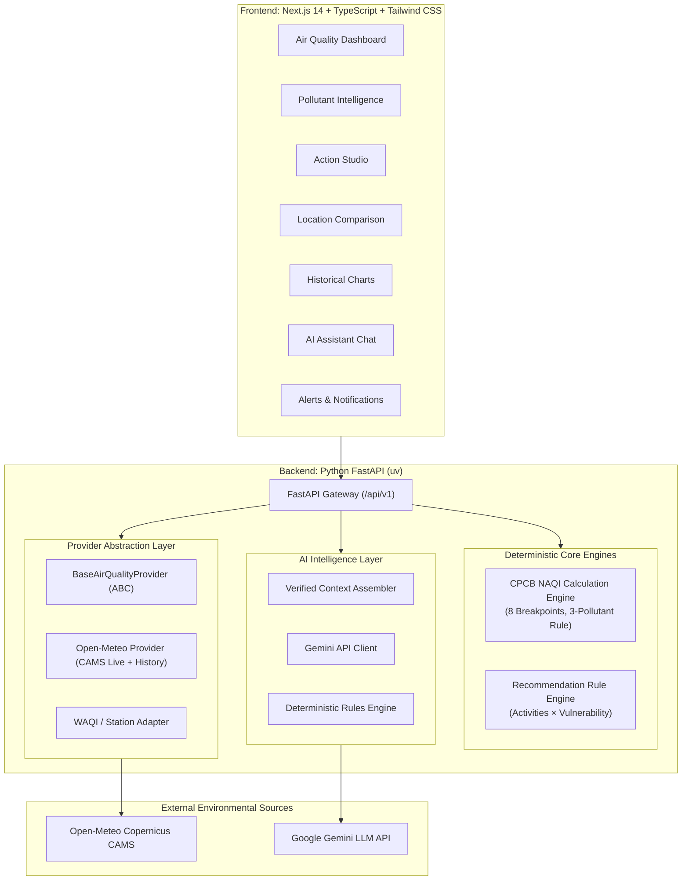

# AirAware AI — Intelligent Urban Air Quality Monitoring & Personalised Action Assistant

> **A production-ready environmental intelligence platform that transforms real atmospheric data into location-aware, accessible, and actionable health guidance using India's official CPCB National Air Quality Index (NAQI) standard.**

---

## 1. Project Overview

**AirAware AI** is an intelligent environmental health companion designed to solve the acute usability, reliability, and data integrity challenges associated with urban air pollution. 

Unlike generic AQI apps that merely display raw numbers or attach an ungrounded chatbot that hallucinates air quality values, AirAware AI integrates **verified, real-world criteria pollutant measurements** (PM2.5, PM10, NO2, SO2, CO, O3) and evaluates them through the **official Central Pollution Control Board (CPCB) National Air Quality Index (NAQI)** calculation methodology. It couples this with a **deterministic, evidence-based Personalised Action Studio** and a **strictly grounded AI conversational assistant** that operates reliably both online and completely offline.

---

## 2. Problem Statement

Rapid urbanization and seasonal meteorological inversions across South Asia and global metropolitan areas have made air pollution a persistent public health emergency. However, urban residents encounter severe barriers with existing tools:
1. **Misleading AQI Calculations**: Many consumer dashboards label raw PM2.5 concentrations as "AQI" or apply US EPA breakpoints to Indian atmospheric baselines, leading to confusion.
2. **Abstract Numbers Without Context**: Telling a citizen that AQI is "240" offers little clarity on which specific pollutant is driving the toxicity or what concrete precautions to take.
3. **One-Size-Fits-All Advice**: A marathon runner, an asthmatic child, and an office commuter require starkly different preventive measures.
4. **AI Hallucinations**: Standard LLMs invent air quality readings, hallucinate historical trends, or prescribe speculative medical therapies.
5. **Data Fabrication**: Many prototype dashboards rely on mock data or silently replace missing sensor measurements with zero, distorting public health reality.

---

## 3. Proposed Solution

AirAware AI addresses these foundational issues through five engineering pillars:
- **Zero Mock / Zero Fabricated Data**: Direct integration with verified atmospheric reanalysis and in-situ monitoring models (Open-Meteo & Copernicus Atmosphere Monitoring Service - CAMS) with clear observation timestamps and provenance.
- **Official CPCB NAQI Engine**: Strict implementation of India's CPCB 8-pollutant linear interpolation formula, complete with official concentration breakpoints and the mandatory 3-pollutant sufficiency rule (including PM2.5/PM10).
- **Deterministic Personalised Action Studio**: Rule-based decision matrix mapping AQI categories, dominant pollutants, 6 activity types, 6 vulnerability cohorts, and exposure durations to actionable precautions.
- **Grounded AI Assistant with Offline Fallback**: Conversational agent that interprets verified data without hallucinating readings or overriding validated formulas, with a 100% functional offline deterministic rules engine.
- **Transparent Multi-Location & Historical Intelligence**: Comparative analytics and hourly historical trends without fictitious data smoothing.

---

## 4. Key Features

### Feature A — Comprehensive Air Quality Dashboard
- **Semicircular SVG Gauge**: Visualizes composite CPCB AQI with official category colors (Good, Satisfactory, Moderate, Poor, Very Poor, Severe).
- **Dominant Pollutant Callout**: Instantly highlights the primary pollutant driving the AQI and explains why it matters.
- **Provenance Badges**: Displays monitoring location coordinates, observation timestamp, retrieval timestamp, data source, and freshness indicator.

### Feature B — Pollutant Intelligence Grid
- **Real-Time Breakdown**: Interactive cards for PM2.5, PM10, NO2, SO2, CO, and O3 with standard concentrations ($\mu g/m^3$, $mg/m^3$) and individual sub-indices.
- **Educational Deep-Dive**: Modals explaining chemical nature, primary emission sources (vehicular, industrial, agricultural), and acute vs. chronic respiratory effects.
- **Honest Missing Data Handling**: Missing or unmonitored sensors are explicitly labeled as "Sensor Unavailable" rather than silently assumed to be zero.

### Feature C — Personalised Action Studio
- **Multi-Factor Customization**:
  - **Activities**: Walking, Running, Cycling, Commuting, Outdoor Sports, Indoor.
  - **Sensitivity Cohorts**: General Adults, Children (<14 yrs), Elderly (60+ yrs), Asthma/Respiratory, Cardiovascular, Pregnant Individuals.
  - **Exposure Duration**: <30 mins, 30–60 mins, 1–2 hours, >2 hours.
- **Actionable Outputs**: Risk advisory level, step-by-step precautions, certified respiratory mask recommendations (N95/FFP2), indoor ventilation advice, and health disclaimers.

### Feature D — Multi-Location Comparison
- **Matrix Comparator**: Compare 2 to 6 monitored cities simultaneously (e.g., Delhi, Mumbai, Bengaluru, Kolkata, Chennai, Hyderabad).
- **Side-by-Side Pollutant Breakdown**: Instant comparative analysis of AQI, dominant pollutants, and individual concentrations.
- **Data Integrity Safeguard**: Warns users against comparing locations with disparate observation intervals or stale timestamps.

### Feature E — Verified Historical Trends
- **Hourly Historical Observations**: Area charts plotting 24 hours, 7 days, 14 days, or 30 days of real atmospheric data.
- **Metric Toggling**: Switch between AQI, PM2.5, PM10, NO2, SO2, CO, and O3.
- **Statistical Summary**: Instant calculation of period average, peak concentration, and cleanest recorded hour.

### Feature F — Grounded AI Assistant
- **Verified Context Injection**: Feeds immutable environmental readings into the prompt.
- **Quick Suggested Chips**: Single-click access to critical inquiries ("What does the AQI mean?", "Is running safe?", "Which pollutant is contributing most?").
- **Offline Deterministic Fallback**: Provides reasoned, evidence-based answers even when no external LLM API key is present.

### Feature G — User-Configurable Threshold Alerts
- **Customizable Thresholds**: Set personalized AQI alerts (e.g., trigger when AQI > 200).
- **Duplicate Prevention**: Intelligently deduplicates alert triggers within a 3-hour window to avoid alert fatigue.
- **Persistent Notification Log**: Stored safely in client-side storage.

### Feature H — Methodology & Provenance Transparency
- Complete documentation of CPCB breakpoints, interpolation formula, and data provider attribution accessible directly within the application.

---

## 5. System Architecture



---

## 6. Technologies Used

- **Frontend**: Next.js 14 (App Router), React 18, TypeScript, Tailwind CSS, Lucide React, Recharts.
- **Backend**: Python 3.11, FastAPI, Pydantic v2, Uvicorn, HTTPX (Async), Python-Dotenv.
- **Tooling & Package Management**: Astral `uv` (high-performance Python tooling), npm, Node.js v22.
- **Testing**: Pytest, Pytest-Asyncio, FastAPI TestClient.

---

## 7. Data Sources & Provenance

AirAware AI queries real atmospheric observations and reanalysis data:
- **Primary Live & Historical Provider**: Open-Meteo Air Quality API powered by the **Copernicus Atmosphere Monitoring Service (CAMS)** and global in-situ station networks.
- **Averaging Periods**: 24-hour equivalent for PM2.5, PM10, NO2, SO2, NH3, Pb; 8-hour equivalent for CO and O3.
- **Units**: Concentrations are in standard metric units ($\mu g/m^3$ for particulate matter and gases; $mg/m^3$ for carbon monoxide).
- **Pluggable Architecture**: Includes extensible adapter interfaces for direct CPCB Central Control Room / data.gov.in and WAQI station feeds.

---

## 8. CPCB AQI Methodology

Under India's **Central Pollution Control Board (CPCB) National Air Quality Index** guidelines:

### Sub-Index Interpolation Formula
$$I_p = \frac{I_{hi} - I_{lo}}{B_{hi} - B_{lo}} \times (C_p - B_{lo}) + I_{lo}$$

Where:
- $C_p$ = Pollutant concentration
- $B_{hi}, B_{lo}$ = Breakpoint concentration interval containing $C_p$
- $I_{hi}, I_{lo}$ = Sub-index interval corresponding to $B_{hi}, B_{lo}$

### CPCB Official Breakpoints Table

| Category | AQI Range | PM10 (24h) | PM2.5 (24h) | NO2 (24h) | O3 (8h) | CO (8h, mg/m³) | SO2 (24h) |
|---|---|---|---|---|---|---|---|
| **Good** | 0 – 50 | 0 – 50 | 0 – 30 | 0 – 40 | 0 – 50 | 0.0 – 1.0 | 0 – 40 |
| **Satisfactory** | 51 – 100 | 51 – 100 | 31 – 60 | 41 – 80 | 51 – 100 | 1.1 – 2.0 | 41 – 80 |
| **Moderate** | 101 – 200 | 101 – 250 | 61 – 90 | 81 – 180 | 101 – 168 | 2.1 – 10.0 | 81 – 380 |
| **Poor** | 201 – 300 | 251 – 350 | 91 – 120 | 181 – 280 | 169 – 208 | 10.1 – 17.0 | 381 – 800 |
| **Very Poor** | 301 – 400 | 351 – 430 | 121 – 250 | 281 – 400 | 209 – 748 | 17.1 – 34.0 | 801 – 1600 |
| **Severe** | 401 – 500 | 430+ | 250+ | 400+ | 748+ | 34.0+ | 1600+ |

### CPCB Sufficiency Rules Enforced by AirAware AI
1. **Minimum 3 Pollutants**: At least three criteria pollutants must be present.
2. **Mandatory Particulate Matter**: At least one of PM10 or PM2.5 MUST be monitored.
3. **Composite AQI**: Overall AQI = $\max(I_{PM2.5}, I_{PM10}, I_{NO2}, I_{SO2}, I_{CO}, I_{O3}, \dots)$.
4. **Dominant Pollutant**: Pollutant with $I_p = \text{Overall AQI}$.

---

## 9. How the Application Works

1. **Selection & Ingestion**: The user chooses a city from the quick switcher, searches for an urban center, or passes custom coordinates.
2. **Verification & Calculation**: The backend fetches live atmospheric readings from Open-Meteo, normalizes units, and feeds them into `cpcb_calculator.py`.
3. **Deterministic Evaluation**: `recommendation_rules.py` cross-references the AQI and dominant pollutant with the user's selected activity, vulnerability cohort, and exposure duration.
4. **Context Grounding**: The AI assistant accepts the verified state as an immutable context envelope, answering questions without speculative extrapolation.
5. **Real-time Alerting**: The frontend checks the calculated AQI against client-configured alert rules and surfaces immediate warning banners if thresholds are crossed.

---

## 10. AI Service Usage & Limitations

- **Strict Grounding**: The LLM prompt is assembled with pre-calculated, verified environmental context. The system instruction strictly prohibits inventing numbers, overriding calculated categories, or making ungrounded causal claims.
- **Non-Medical Boundary**: The AI assistant explicitly refuses to prescribe medical therapies, diagnose diseases, or offer clinical guarantees.
- **Offline / Zero-Config Operation**: If `GEMINI_API_KEY` is not provided or upstream network requests fail, the application falls back seamlessly to its internal deterministic rules engine, providing instant, accurate answers to common inquiries without breaking.

---

## 11. Installation Instructions

### Prerequisites
- Node.js (v18+ or v22 LTS)
- Python 3.11+
- Astral `uv` (recommended) or standard `pip`

### Step 1: Clone the Repository
```bash
git clone https://github.com/<your-username>/AirAware-AI.git
cd AirAware-AI
```

### Step 2: Configure Environment Variables
```bash
cp .env.example .env
```

### Step 3: Backend Setup
```bash
cd backend
# Using uv (recommended)
uv venv
uv pip install -e ".[dev]"

# Or using standard venv:
python -m venv .venv
source .venv/bin/activate  # On Windows: .venv\Scripts\activate
pip install -e ".[dev]"
```

### Step 4: Frontend Setup
```bash
cd ../frontend
npm install
```

---

## 12. Environment Variables

See `.env.example`:

| Variable | Description | Default / Required |
|---|---|---|
| `PORT` | FastAPI backend server port | `8000` |
| `HOST` | Backend bind address | `127.0.0.1` |
| `ALLOWED_ORIGINS` | CORS permitted origins | `http://localhost:3000,http://127.0.0.1:3000` |
| `GEMINI_API_KEY` | Google Gemini API key for conversational AI | *Optional* (Full offline fallback included) |
| `WAQI_API_TOKEN` | World Air Quality Index station feed token | *Optional* |
| `DATA_GOV_IN_API_KEY` | Open Government Data Platform India key | *Optional* |

---

## 13. Testing Instructions

AirAware AI includes a comprehensive automated test suite covering CPCB breakpoint calculations, edge cases, negative values, 3-pollutant rules, recommendation matrices, and API route validation.

### Run Backend Pytest Suite
```bash
cd backend
.venv\Scripts\pytest.exe tests -v
# Or with uv:
uv run pytest tests -v
```

### Test Suite Coverage:
- `test_pm25_sub_index_breakpoints`: Verifies exact CPCB interpolation at 0, 15, 30, 60, 75, 120, 250, and 300 $\mu g/m^3$.
- `test_pm10_sub_index_breakpoints`: Validates PM10 breakpoint transitions.
- `test_co_sub_index_breakpoints`: Validates CO in $mg/m^3$.
- `test_extreme_values_and_capping`: Verifies handling of extreme smog readings (>500 cap).
- `test_negative_concentration_handling`: Confirms negative sensor anomalies are rejected.
- `test_cpcb_insufficient_data_less_than_three_pollutants`: Validates CPCB 3-pollutant sufficiency rule.
- `test_cpcb_insufficient_data_missing_pm`: Validates mandatory PM2.5/PM10 requirement.
- `test_cpcb_success_calculation_and_dominant_pollutant`: Tests composite AQI and dominant pollutant selection.
- `test_recommendation_engine`: Tests advisory escalations across activities and vulnerability cohorts.
- `test_api_routes`: End-to-end FastAPI endpoint integration, sanitization, and coordinate bounds validation.

### Run Frontend Build & Typecheck
```bash
cd frontend
npm run build
```

---

## 14. Deployment Instructions

### Option A: Local / Self-Hosted Production

1. **Start Backend**:
   ```bash
   cd backend
   .venv\Scripts\uvicorn.exe app.main:app --host 0.0.0.0 --port 8000
   ```
2. **Start Frontend**:
   ```bash
   cd frontend
   npm run build
   npm run start
   ```
   Open `http://localhost:3000` in any modern web browser.

### Option B: Cloud Hosting (e.g. Render / Vercel / Railway / Docker)
- Deploy `backend/` to any containerized Python service (Render / Railway / GCP Cloud Run).
- Deploy `frontend/` to Vercel or Netlify, pointing `NEXT_PUBLIC_API_URL` to your live backend domain.

---

## 15. Assumptions & Limitations

1. **Averaging Windows**: In-situ continuous ambient air quality stations calculate 24-hour moving averages. When querying remote meteorological models like Copernicus CAMS, hourly observations represent current hourly simulations and reanalysis.
2. **Lead (Pb) & Ammonia (NH3)**: CPCB NAQI defines breakpoints for 8 pollutants. Lead (Pb) is measured manually via filter paper gravimetry and is rarely available in real-time telemetry; ammonia (NH3) sensors are only present in select tier-1 stations. AirAware AI gracefully marks these as unavailable without failing the overall calculation when other criteria pollutants suffice.
3. **Non-Clinical Nature**: Preventive recommendations are strictly educational and non-clinical.

---

## 16. Future Improvements

- **Local IoT Sensor Integration**: Direct Bluetooth / Wi-Fi pairing with personal low-cost particulate monitors (e.g., Plantower PMS5003).
- **Hyperlocal Route Optimization**: Clean-air commuting route navigation suggesting walking and cycling paths that avoid high-emission traffic arteries.
- **Push & WhatsApp Notification Webhooks**: Automated daily morning briefings delivering the day's predicted air quality and activity advice before morning commutes.
- **Community Ground-Truth Reporting**: Crowdsourced reporting of localized biomass burning, construction dust plumes, and industrial flare-ups.

---

## License

This project is licensed under the Apache 2.0 License.
