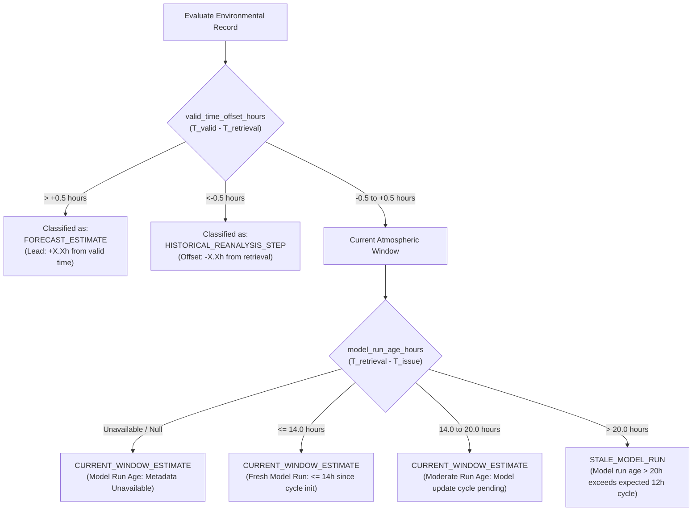

# AirAware AI — Architecture Specification Version 2.2 (Final Technical Amendments)

**Document Version:** 2.2.0 (Final Architecture Baseline)  
**Status:** Pre-Implementation Specification — Approved Baseline with Final Technical Amendments  
**Focus:** Scientific Data Semantics, Native Temporal Resolution Integrity, Non-Arbitrary Freshness Governance & Test Invariants  

---

## 1. Challenge Requirement Verification Matrix

All requirements remain formally classified into three distinct categories. **Tier 1 requirements are explicitly marked as pending formal verification against the official Hack2Skill Challenge 6 statement text.**

```
[Tier 1: Challenge Requirements — Pending Verification against Official Hack2Skill Challenge 6 Statement]
  ├── [P-REQ-01] Location-specific air quality assessment
  ├── [P-REQ-02] Identification of key contributing air pollutants
  ├── [P-REQ-03] Interpretation and health significance of observed values
  ├── [P-REQ-04] Personalised, evidence-based precautionary guidance
  ├── [P-REQ-05] Comparative evaluation of air quality across locations
  ├── [P-REQ-06] Exploration of historical environmental patterns (where genuine records exist)
  ├── [P-REQ-07] Conversational natural-language interface for air quality inquiries
  └── [P-REQ-08] Transparent disclosure of data sources, observation timestamps, and reliability

[Tier 2: Engineering Architecture Decisions — Formulated by Our Engineering Team]
  ├── [ENG-DEC-01] Application of CPCB NAQI breakpoints to criteria pollutant concentrations
  ├── [ENG-DEC-02] Pollutant-specific averaging periods (24h for PM/gases; 8h for CO/O3)
  ├── [ENG-DEC-03] Separate documentation of station completeness rules vs. model processing assumptions
  ├── [ENG-DEC-04] Clear taxonomy: Physical Station Data vs. Modelled Atmospheric Grid Estimates
  ├── [ENG-DEC-05] Open-Meteo (Copernicus CAMS) as primary verified zero-config provider
  ├── [ENG-DEC-06] Deterministic health matrix linking CPCB/WHO advisories to activities & cohorts
  ├── [ENG-DEC-07] Strict backend trust boundary: Server-authoritative calculations; client context rejected
  └── [ENG-DEC-08] Rigorous temporal semantics: model_issue_time, valid_time, retrieval_time, model_run_age_hours, forecast_lead_hours, valid_time_offset_hours

[Tier 3: Additional Product Enhancements — Proposed by Our Team]
  ├── [PROP-FEAT-01] Client-side threshold alert manager with 3-hour deduplication window
  ├── [PROP-FEAT-02] Multi-city comparison warning on observation timestamp discrepancies
  ├── [PROP-FEAT-03] Interactive Recharts visualizer with statistical indicators (avg, peak, minimum)
  └── [PROP-FEAT-04] In-memory spatial TTL cache for rate-limiting protection with documented multi-worker limits
```

---

## 2. Corrected Temporal Semantics & Data-Age Calculation

### 2.1 Why Simple Subtraction Fails
Calculating data age as `retrieval_time - valid_time` is mathematically and conceptually incorrect whenever working with forecast data, where `valid_time > retrieval_time` produces a negative number. Furthermore, it confuses **how old the forecast model run is** with **what point in time the environmental slice represents**.

### 2.2 Decoupled Temporal Architecture
AirAware AI formally defines and exposes six independent temporal concepts:

```
                  ┌─────────────────────────────────────────────────────────┐
                  │                 Timeline of Events                      │
                  └─────────────────────────────────────────────────────────┘
        model_issue_time                 retrieval_time               valid_time (Forecast)
               │                                │                                │
               ▼                                ▼                                ▼
───────────────┼────────────────────────────────┼────────────────────────────────┼───────────────► Time (UTC)
               │◄───── model_run_age_hours ────►│                                │
               │                                │◄── valid_time_offset_hours ───►│
               │◄────────────────── forecast_lead_hours ────────────────────────►│
```

1. **`model_issue_time`** ($T_{\text{issue}}$):  
   The actual UTC base initialization timestamp of the numerical weather / atmospheric chemistry model run (e.g., CAMS global 00:00 UTC or 12:00 UTC cycle).  
   *Rule:* If the upstream provider does not expose model initialization metadata in its response headers or payload, **this field must be returned as `null` and explicitly marked as unavailable. It must NEVER be fabricated or guessed.**
2. **`valid_time`** ($T_{\text{valid}}$):  
   The exact UTC timestamp represented by the environmental concentration slice (the target point in time).
3. **`retrieval_time`** ($T_{\text{retrieval}}$):  
   The wall-clock UTC timestamp when AirAware AI received and processed the response from the upstream provider.
4. **`model_run_age_hours`** ($\Delta T_{\text{run}}$):  
   $$\Delta T_{\text{run}} = \frac{T_{\text{retrieval}} - T_{\text{issue}}}{3600\text{ s}} \quad (\text{if } T_{\text{issue}} \neq \text{null, else null})$$
   Measures the operational age of the model cycle itself (how long ago the numerical simulation was computed).
5. **`forecast_lead_hours`** ($\Delta T_{\text{lead}}$):  
   $$\Delta T_{\text{lead}} = \frac{T_{\text{valid}} - T_{\text{issue}}}{3600\text{ s}} \quad (\text{if } T_{\text{issue}} \neq \text{null, else null})$$
   Measures how far into the future from model initialization the slice was projected.
6. **`valid_time_offset_hours`** ($\Delta T_{\text{offset}}$):  
   $$\Delta T_{\text{offset}} = \frac{T_{\text{valid}} - T_{\text{retrieval}}}{3600\text{ s}}$$
   - $\Delta T_{\text{offset}} > +0.5\text{ h}$: Future forecast step.
   - $-0.5\text{ h} \le \Delta T_{\text{offset}} \le +0.5\text{ h}$: Current real-time atmospheric window.
   - $\Delta T_{\text{offset}} < -0.5\text{ h}$: Historical reanalysis / hindcast step.

---

## 3. CAMS Global Native Temporal Resolution & Interpolation Integrity

### 3.1 Scientific Reality: CAMS Native 3-Hour Output Step
The Copernicus Atmosphere Monitoring Service (CAMS) Global Atmospheric Composition Model produces output at **native 3-hour temporal intervals** (00:00, 03:00, 06:00, 09:00, 12:00, 15:00, 18:00, 21:00 UTC).

When upstream consumer APIs (such as Open-Meteo) return hourly time-series:
> **CRITICAL SCIENTIFIC INVARIANT:**  
> **Intermediate hourly values (e.g. 01:00, 02:00, 04:00 UTC) are generated via temporal interpolation between native 3-hourly CAMS simulation nodes. Interpolation does NOT create additional independent atmospheric observations.**

### 3.2 Technical Requirements for Model Temporal Handling
1. **Resolution Attribution**: Every API response and UI card must record the provider's native temporal resolution:  
   `native_temporal_resolution: "3-hour native output step (Copernicus CAMS Global)"`
2. **Interpolation Disclosure**: When intermediate hourly steps are displayed or processed, the payload documents:  
   `temporal_interpolation_applied: "Hourly series generated by temporal interpolation between 3-hourly CAMS simulation steps"`
3. **Preservation of Raw Timestamps & Values**: The provider layer retains the raw discrete timestamps and concentration values without destructive post-processing.
4. **Validation of Rolling Window Calculations**:
   - **24-Hour Rolling Average**: Across a 24-hour window, there are **8 native 3-hour CAMS nodes**. The calculation is mathematically valid as a numerical integration of the atmospheric profile, provided all 8 native intervals are present.
   - **8-Hour Rolling Average**: Across an 8-hour window, there are at most **2 to 3 native 3-hour CAMS nodes**. Calculating an 8-hour average from interpolated hourly points is an approximation of 2–3 underlying nodes.
   - **Sufficiency Rule**: If upstream data gaps result in fewer than 6 native nodes in a 24-hour window or fewer than 2 native nodes in an 8-hour window, the engine returns `status: "INSUFFICIENT_DATA"` rather than extrapolating.
5. **No Station Assumption Conflation**: The engine **never** applies the statutory CPCB physical station rule ("16 individual valid hourly station logs out of 24") to interpolated model outputs. They are governed by separate, documented model completeness invariants.

---

## 4. Non-Arbitrary Freshness Classification Policy

AirAware AI does not present arbitrary freshness thresholds as official provider standards. The classification rules are explicitly documented as **AirAware Engineering Evaluation Policies**, calibrated directly against ECMWF/CAMS operational publication cycles (which publish new runs twice daily at ~10:00 UTC and ~22:00 UTC):



### Policy Invariants:
1. **Forecast Steps Are Never Labeled Stale**: A future forecast step ($\Delta T_{\text{offset}} > +0.5\text{h}$) is **never** classified as "stale" simply because its valid time is ahead of retrieval time. It is categorized as `FORECAST_ESTIMATE`.
2. **Separate Dimensions**: Model run age ($\Delta T_{\text{run}}$), forecast lead time ($\Delta T_{\text{lead}}$), and valid time offset ($\Delta T_{\text{offset}}$) are maintained in separate schema fields and never collapsed into a single lossy string.

---

## 5. CPCB Methodology & Model-Derived Index Semantics

### 5.1 CPCB Linear Interpolation Formula
$$I_p = \frac{I_{hi} - I_{lo}}{B_{hi} - B_{lo}} \times (C_p - B_{lo}) + I_{lo}$$

### 5.2 Official Breakpoints Matrix (8 Criteria Pollutants)

| Category | Index Range | PM10 (24h) | PM2.5 (24h) | NO2 (24h) | O3 (8h) | CO (8h, mg/m³) | SO2 (24h) | NH3 (24h) | Pb (24h) |
|---|---|---|---|---|---|---|---|---|---|
| **Good** | 0 – 50 | 0 – 50 | 0 – 30 | 0 – 40 | 0 – 50 | 0.0 – 1.0 | 0 – 40 | 0 – 200 | 0.0 – 0.5 |
| **Satisfactory** | 51 – 100 | 51 – 100 | 31 – 60 | 41 – 80 | 51 – 100 | 1.1 – 2.0 | 41 – 80 | 201 – 400 | 0.51 – 1.0 |
| **Moderate** | 101 – 200 | 101 – 250 | 61 – 90 | 81 – 180 | 101 – 168 | 2.1 – 10.0 | 81 – 380 | 401 – 800 | 1.01 – 2.0 |
| **Poor** | 201 – 300 | 251 – 350 | 91 – 120 | 181 – 280 | 169 – 208 | 10.1 – 17.0 | 381 – 800 | 801 – 1200 | 2.01 – 3.0 |
| **Very Poor** | 301 – 400 | 351 – 430 | 121 – 250 | 281 – 400 | 209 – 748 | 17.1 – 34.0 | 801 – 1600 | 1201 – 1800 | 3.01 – 3.5 |
| **Severe** | 401 – 500 | 431+ | 251+ | 401+ | 749+ | 34.1+ | 1601+ | 1801+ | 3.51+ |

### 5.3 Methodological Disclosure
- **Index Designation**: Always labeled as **`INDICATIVE_MODEL_INDEX`** when derived from CAMS data.
- **Mandatory Statement**:  
  `"This index is an indicative estimate derived by applying official Central Pollution Control Board (CPCB) NAQI breakpoints to Copernicus CAMS atmospheric chemistry transport model simulations (~40 km grid cell). It does NOT constitute an official physical continuous ambient air quality monitoring station (CAAQMS) bulletin."`

---

## 6. Safety Protocol & Refusal-to-Recommend Policy

> **SAFETY INVARIANT:**  
> **Never generate environmental health recommendations from fabricated, missing, or stale values.**

1. If environmental data is marked `DATA_UNAVAILABLE`, `STALE_MODEL_RUN` ($\Delta T_{\text{run}} > 20\text{h}$), or `INSUFFICIENT_DATA`:
   - The Recommendation Engine **refuses** to generate activity advice or risk tiers.
   - The payload returns `status: "DATA_UNAVAILABLE"` and `advisory_level: "UNKNOWN_CONDITIONS"`.
   - The headline clearly warns:  
     `"Current atmospheric conditions cannot be determined reliably. Health recommendations are withheld to prevent unsafe exposure decisions."`
2. **Evidence-Based Public Health Linkage**: Precautions strictly reflect published advisories from the CPCB NAQI Report (2014/2015) and WHO Global Air Quality Guidelines (2021).
3. **Non-Medical Boundary**: Clear, persistent non-medical disclaimers on every UI view and API response.

---

## 7. Performance Governance & Benchmark Methodology

### 7.1 Provisional Engineering Targets
All figures are marked as **provisional engineering targets**, not empirical results:
- External API round-trip (Open-Meteo CAMS): $250\text{ ms} - 650\text{ ms}$ (Provisional target).
- Backend CPCB & Recommendation execution: $< 3.0\text{ ms}$ (Provisional target).
- In-memory cache lookup: $< 15.0\text{ ms}$ (Provisional target).

### 7.2 Empirical Benchmark Procedure
Empirical results will only be reported after executing the following test script:
```python
# benchmark_suite.py (Specification)
# Records:
# 1. Host OS, CPU model, RAM, Python version
# 2. External Provider: 100 sequential HTTP requests to Open-Meteo CAMS; records median (p50), p95, and failure rate
# 3. Calculation Engine: 10,000 iterations of CPCB rolling average & breakpoint interpolation; records p50 and p95 CPU time via time.perf_counter_ns()
# 4. Recommendation Engine: 10,000 evaluations across all 6 activities x 6 cohorts x 4 durations; records p50 and p95 CPU time
# 5. Cache Layer: 1,000 cached lookups; records p50 and p95 memory retrieval time
```

---

## 8. Updated Implementation Acceptance Criteria & Automated Tests

In addition to existing tests, Version 2.2 adds strict automated test coverage for the technical amendments:

| Test Case Identifier | Target Behavior | Expected Verification Standard |
|---|---|---|
| **`test_temporal_future_forecast`** | Payload with `valid_time > retrieval_time` | Verifies `valid_time_offset_hours > 0`, `forecast_lead_hours > 0`, and classified as `FORECAST_ESTIMATE` (never flagged as stale). |
| **`test_temporal_old_model_future_valid`** | Model run 20 hours ago projecting 5 hours ahead | Verifies `model_run_age_hours = 20.0`, `valid_time_offset_hours = +5.0`, and tagged as `STALE_MODEL_RUN`. |
| **`test_temporal_missing_issue_time`** | Provider payload omits model initialization metadata | Verifies `model_issue_time` is strictly `null` (not fabricated), and `model_run_age_hours` is `null`. |
| **`test_cams_native_resolution_disclosure`** | Any CAMS response payload | Verifies `native_temporal_resolution` is `"3-hour native output step (Copernicus CAMS Global)"` and interpolation is documented. |
| **`test_rolling_window_sufficiency`** | 24-hr window with fewer than 6 native CAMS nodes | Engine returns `INSUFFICIENT_DATA` rather than extrapolating missing nodes. |
| **`test_refusal_to_recommend_stale`** | Recommendation request for location with data age $> 20$ hours | Recommendation engine refuses to issue advice; returns `advisory_level: "UNKNOWN_CONDITIONS"`. |
| **`test_refusal_to_recommend_unavailable`**| Recommendation request when external provider returns 502/network error | Refuses to generate precautions; returns `status: "DATA_UNAVAILABLE"`. |
| **`test_trust_boundary_rejection`** | Client attempts to pass `aqi=150` in `POST /recommendations` | Request rejected with HTTP 422 Unprocessable Entity or ignored; backend calculates server-side. |

---

## 9. Final Pre-Implementation Checklist

- [ ] **Data Age**: `retrieval_time - valid_time` calculation replaced with decoupled `model_issue_time`, `valid_time`, `retrieval_time`, `model_run_age_hours`, `forecast_lead_hours`, and `valid_time_offset_hours`.
- [ ] **Temporal Resolution**: CAMS native 3-hour resolution acknowledged; hourly interpolation documented; rolling window node sufficiency verified.
- [ ] **Freshness Policies**: Documented as AirAware engineering policies based on CAMS 12-hour publication cycles; forecast steps protected from incorrect stale flags.
- [ ] **Uptime & Safety**: 100% uptime claims retracted; strict refusal-to-recommend policy enforced for stale or unavailable data.
- [ ] **Performance Benchmarks**: Marked as provisional engineering targets; formal benchmark protocol specified.
- [ ] **Challenge Requirements**: Tier 1 requirements marked as pending verification against the official Hack2Skill Challenge 6 source document.

*Awaiting formal approval of Version 2.2 before proceeding to implementation.*
